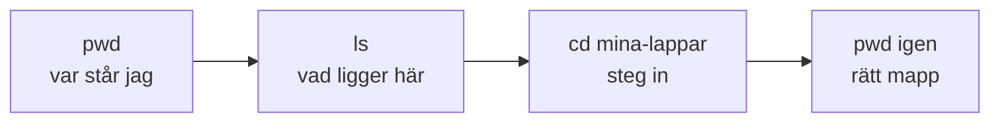
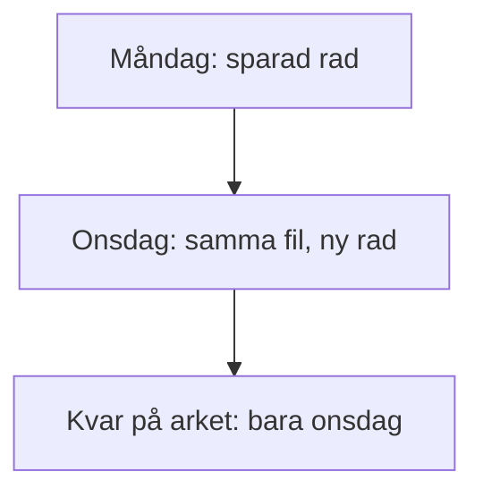
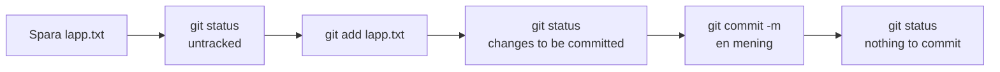
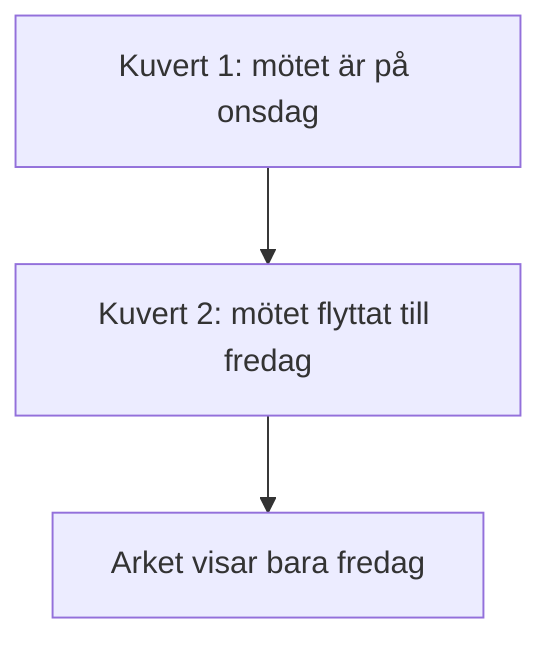

# 02 — Visuellt: från ark till förseglat kuvert

Samma bild som i teoriguiden. Arket är filen du sparar. Kuvertet med öppen flik är staging. Det förseglade kuvertet, med en mening på fliken, är en commit. Lådan är det `git init` skapade i den här mappen.

---

## Platsen först

**Kom ihåg:** Tomt svar från `ls` betyder tom mapp. Det betyder inte att kommandot gick sönder.

---

## Ett ark som skriver över sig

**Kom ihåg:** Spara byter ut arket. Måndagens rad finns inte kvar där.

---

## Tre lägen

**Kom ihåg:** `git add` väljer. `git commit` förseglar. `git status` läser och sparar inget.

---

## Två kuvert, ett ark

**Kom ihåg:** Arket visar slutet. Meningarna på kuverten visar stegen. Kvittot är utskriften från varje commit, inte ett nytt list-kommando.

---

När kartan sitter: [03 — Övningar](./03-ovningar.md).
