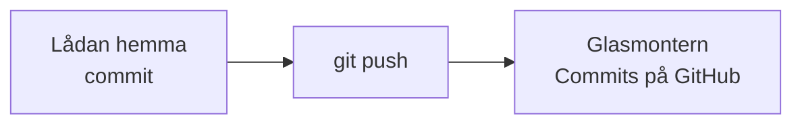
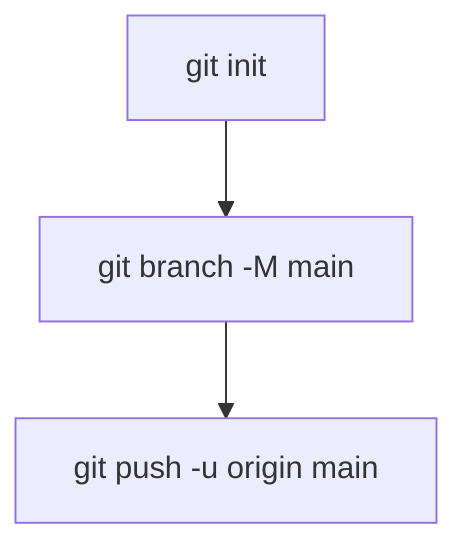
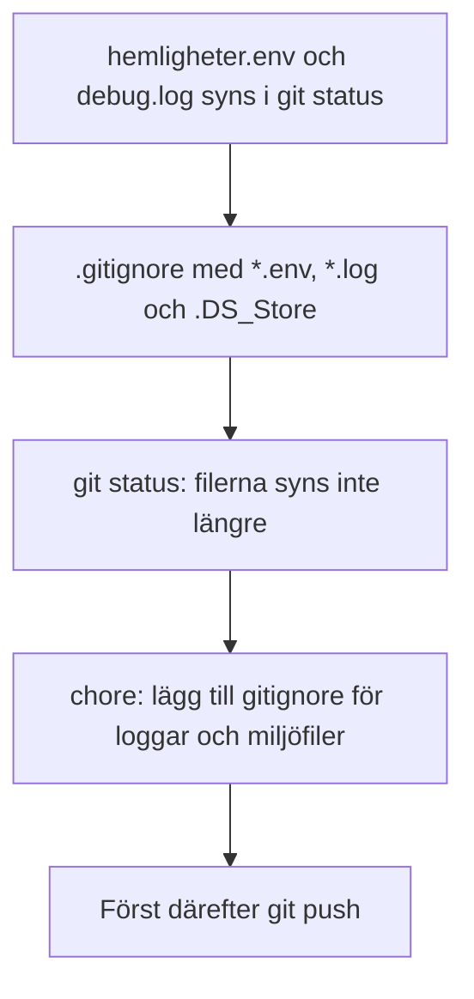
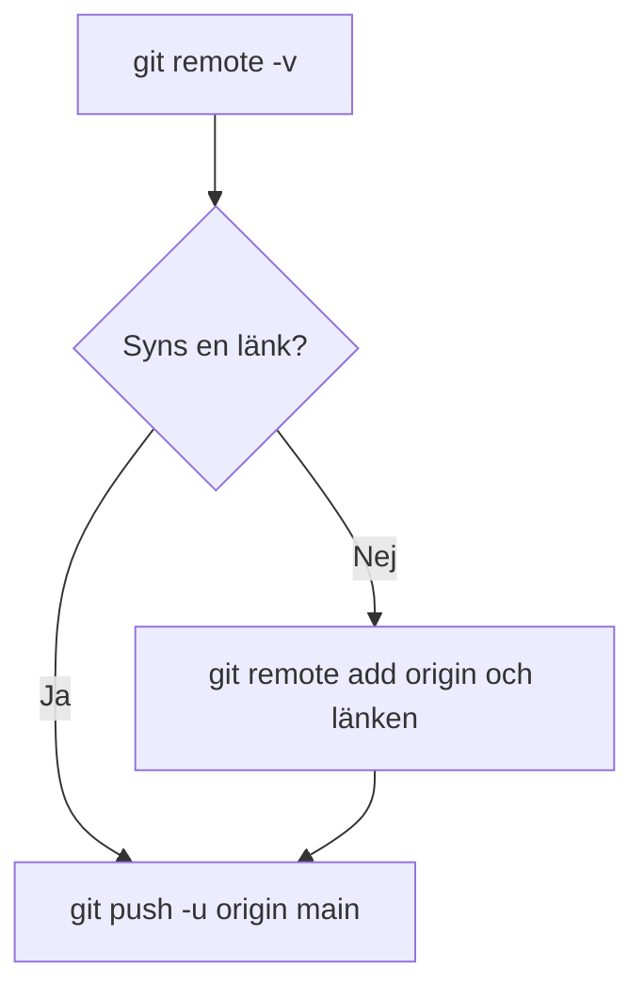
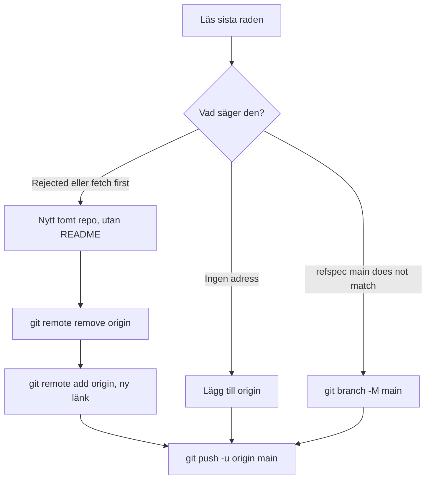
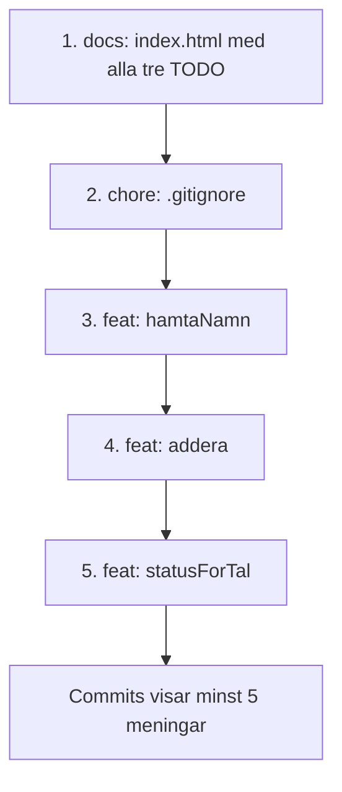

# 02 — Visuellt: lådan och montern

Samma bild som i teoriguiden. Lådan är mappen på din dator. Glasmontern är det publika repot. Adressen på luckan heter remote, smeknamn `origin`. `git push` bär kopian. En commit stannar hemma. `.gitignore` är lappen på locket: vissa papper följer inte med.

---

## Två rum

**Kom ihåg:** Pilen går inte av sig själv. Utan push är montern tom eller gammal.

---

## Namnet main

**Kom ihåg:** `-M` döper om lådan innan första båret. Du byter inte till ett annat gren-namn.

---

## Lappen på locket

**Kom ihåg:** Filerna ligger kvar på disken. De slutar synas i `git status` och följer inte med i push.

---

## Adressen

**Kom ihåg:** Tom lista är en saknad adress, inte en trasig fil.

---

## Röd push

**Kom ihåg:** Du byter monter, eller döper om lådan till `main`. Du hämtar inte hem pappret som redan låg där.

---

## Minst 5 commits

**Kom ihåg:** Klicka den allra äldsta committen. Där ska alla tre TODO fortfarande synas.

---

När kartan sitter: [03 — Övningar](./03-ovningar.md).
