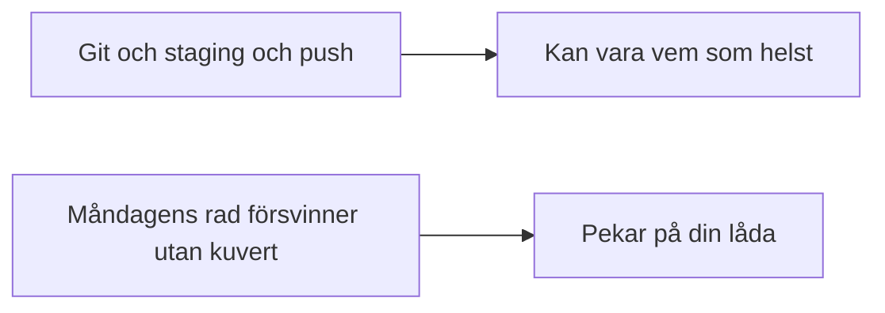
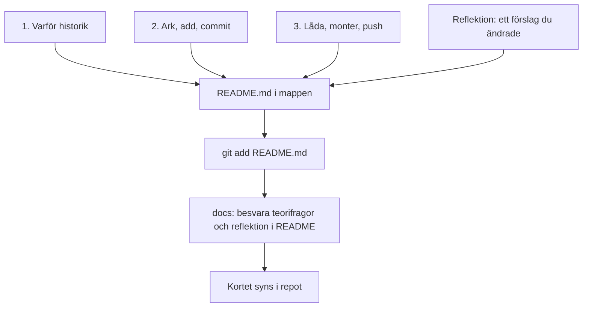
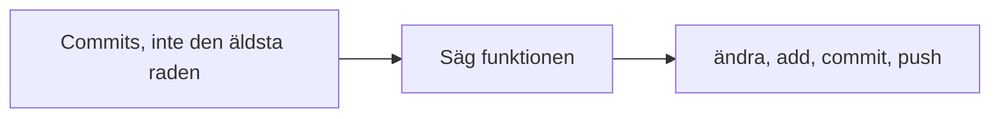
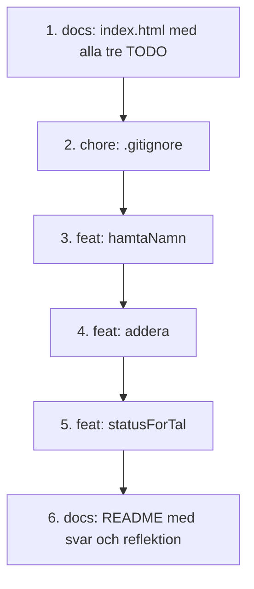

# 02 — Visuellt: kortet följer med

Samma bild som i teoriguiden. `README.md` är kortet i mappen. Push bär det till glasmontern tillsammans med kuverten. En text som bara säger “Git” pekar inte på en rad.

---

## Tunn text, din text

**Kom ihåg:** 2–4 meningar. Stäng filen och säg dem.

---

## Tre frågor, ett kort

**Kom ihåg:** `docs:` är standarden för dokumentation. Kortet hemma är inte inlämnat.

---

## Vad du pekar på

**Kom ihåg:** Sidan med namn, Summa: 12 och ok är kontrollen. Raden är förklaringen.

---

## Minst 6 commits på GitHub

**Kom ihåg:** Klicka den allra äldsta. Där ska alla tre TODO fortfarande synas. Commit 2 är `.gitignore`.

---

När kartan sitter: [03 — Övningar](./03-ovningar.md).
