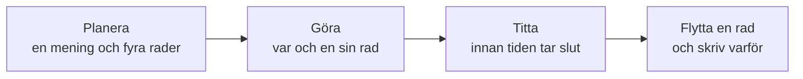
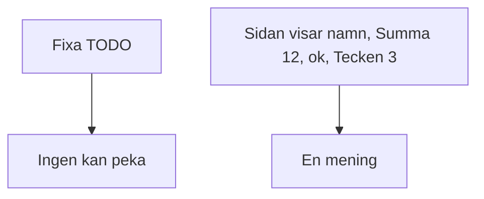
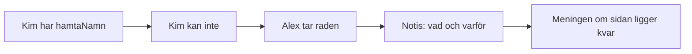

# 02 — Visuellt: rundan

Samma bild som i teoriguiden. En runda har ett slut. Meningen säger vad som ska vara sant då. Raderna har namn. Flyttar en rad, skrivs det. Meningen ligger kvar.

---

## Planera, göra, titta

**Kom ihåg:** Titta är inte ett extra möte med ett eget namn. Det är att hinna se raden medan rundan pågår.

---

## Meningen mot en hög

**Kom ihåg:** Sprintmålet är den högra meningen.

---

## När en rad flyttas

**Kom ihåg:** Raden byter namn. Målet byter inte.

---

När kartan sitter: [03 — Övningar](./03-ovningar.md).
