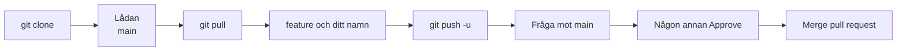
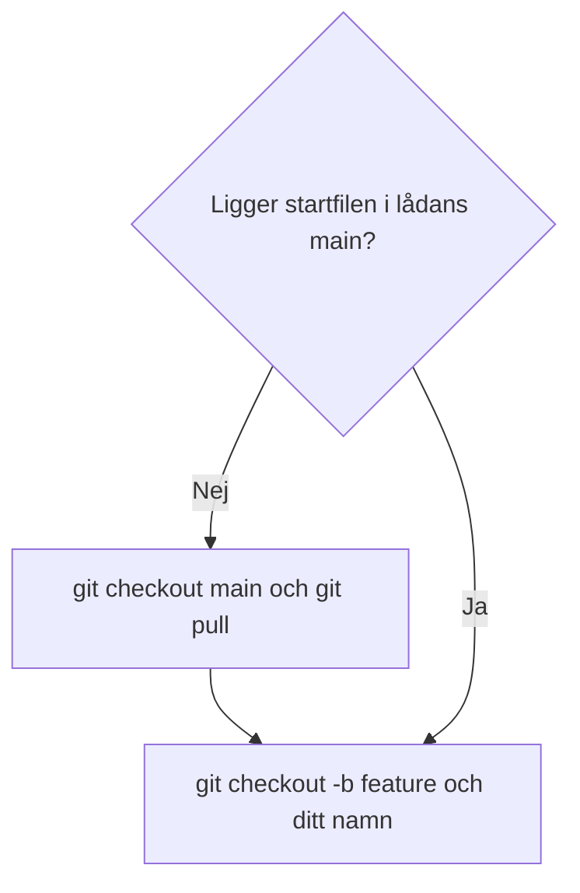
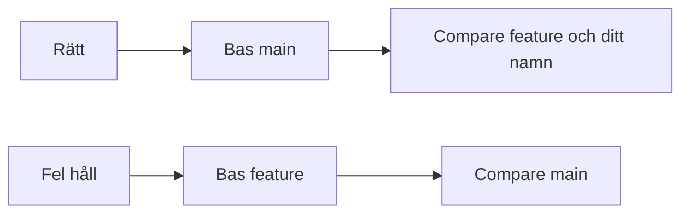

# 02 — Visuellt: sidofacket och frågan

Samma bild som i teoriguiden. Glasmontern är det gemensamma publika repot. Glaset är `main`. Sidofacket heter `feature/` och ditt namn. Lådan är klonen på din dator. Frågan är en Pull Request. Knappen heter Merge pull request.

---

## Från låda till glas

**Kom ihåg:** Push ställer upp sidofacket. Glaset ändras vid knappen.

---

## Sidofacket kopierar lådan

**Kom ihåg:** `checkout -b` läser inte glaset på skärmen. Den läser lådan.

---

## Frågans riktning

**Kom ihåg:** Läs bas och compare innan du skapar frågan. Någon annan Approve. Inte `git merge` i terminalen.
