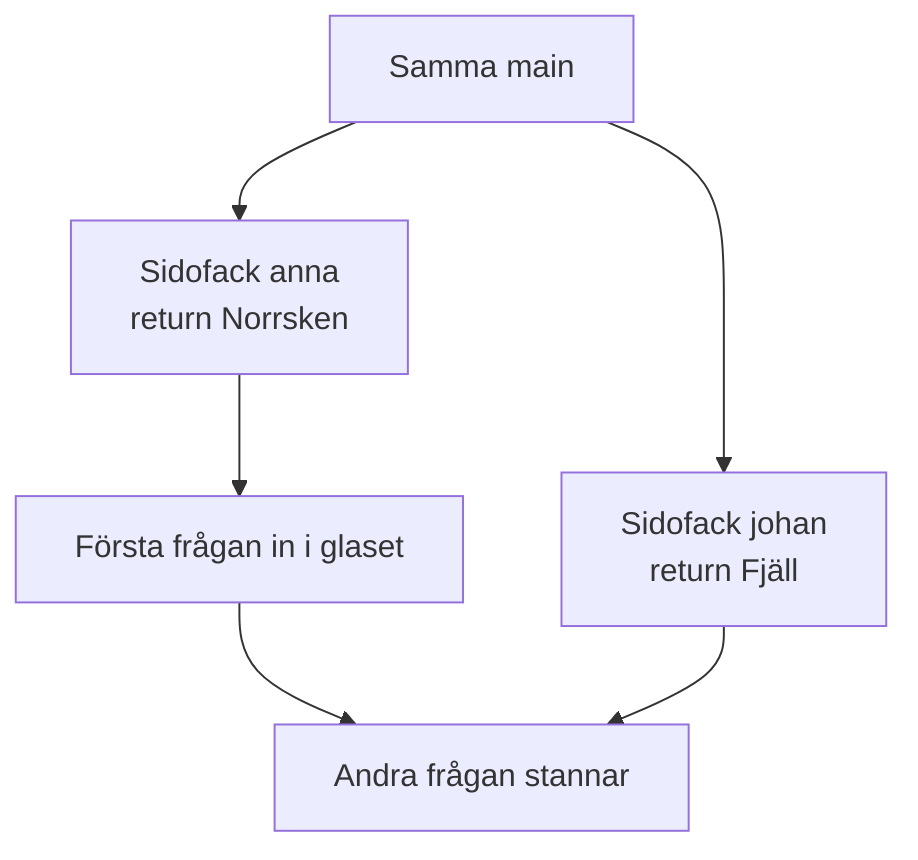
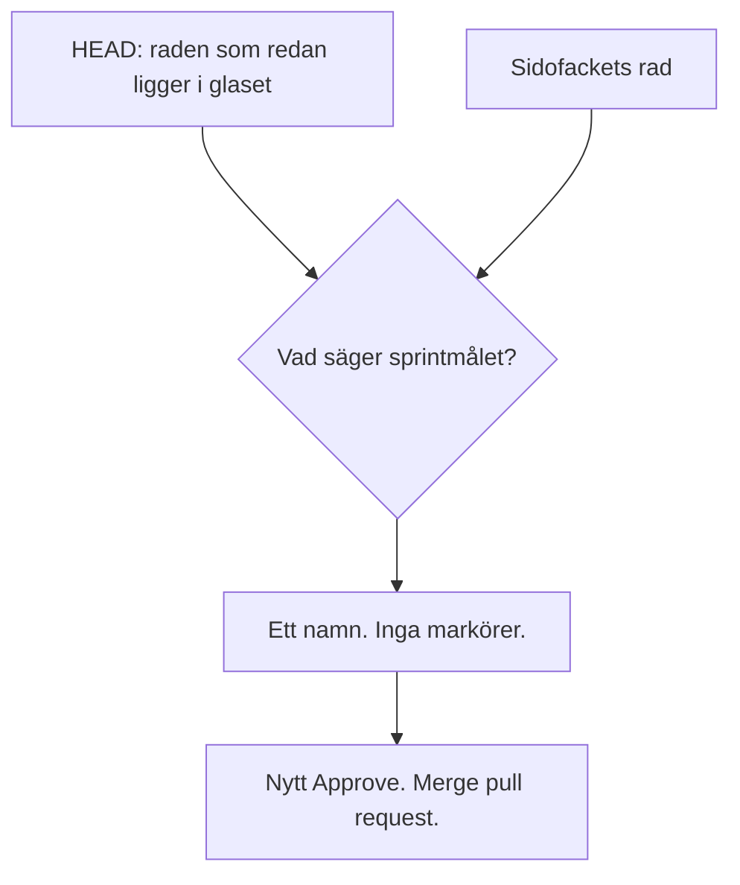
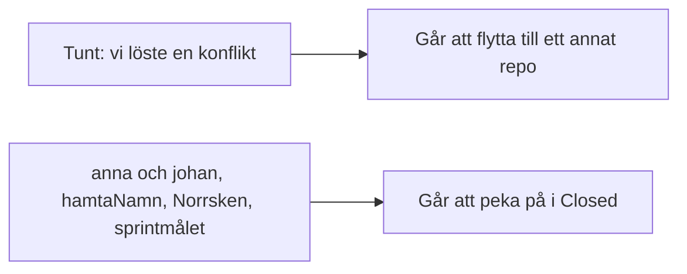

# 02 — Visuellt: samma rad, sedan kortet

Samma bild som i teoriguiden. Två sidofack från samma glas. Båda byter samma rad. Första frågan går in. Den andra stannar. HEAD är raden som redan ligger i glaset. Sprintmålet väljer namnet. Kortet pekar på den raden.

---

## Varför den andra frågan stannar

**Kom ihåg:** Olika funktioner ger inget sådant stopp. Samma rad gör det.

---

## Valet

**Kom ihåg:** Den övre raden vinner inte för att den står först.

---

## Kortet mot Closed

**Kom ihåg:** En mening som kan vara vilken grupp som helst är inte ert svar.
